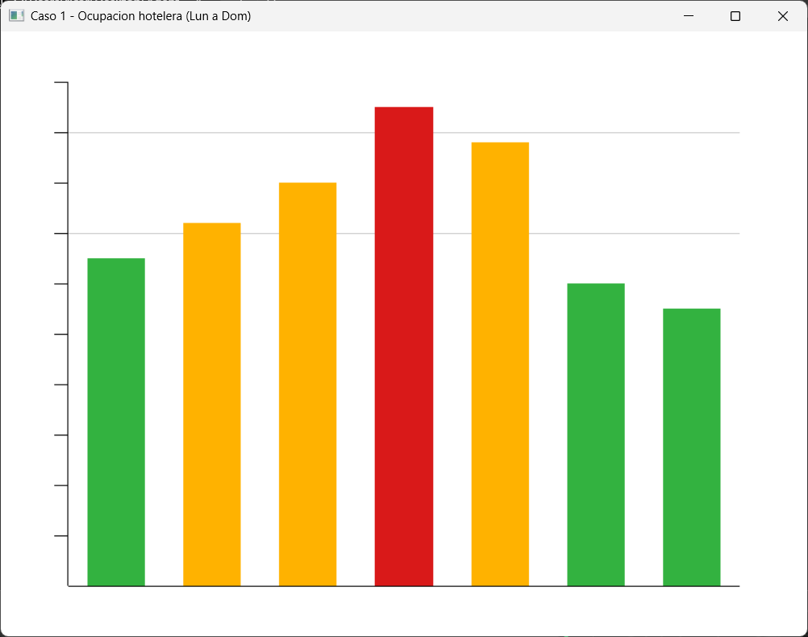
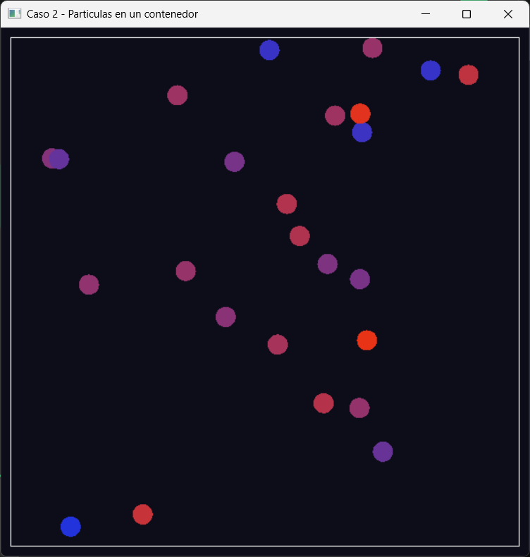
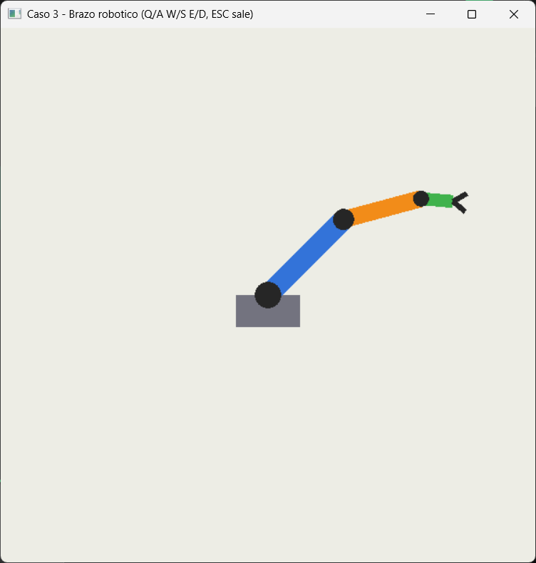
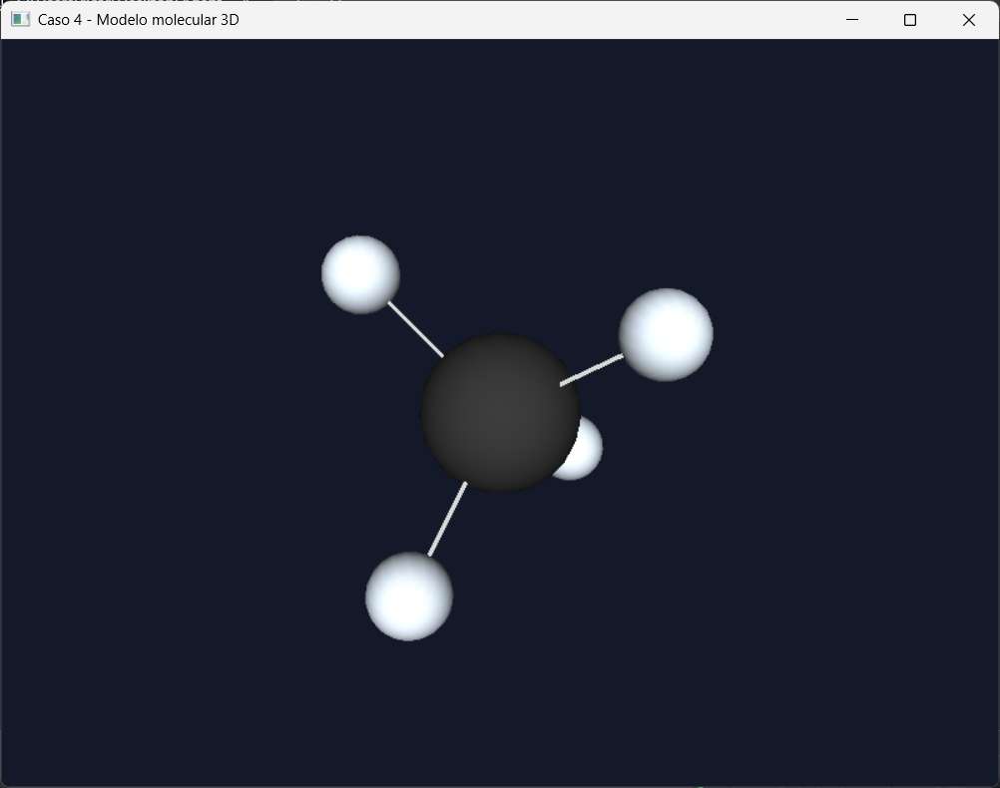

# Práctica Integradora — Computación Gráfica I (ISW-411)

**Universidad Central del Este · Recinto Punta Cana**
*La Computación Gráfica más allá de los videojuegos*

| | |
|---|---|
| **Nombre** | Ricardo Pimentel |
| **Matrícula** | 2023-3776 |
| **Profesor** | Ing. Richard A. Jiménez Rijo |

Cuatro casos de dominios profesionales distintos, resueltos en C con OpenGL/GLUT
usando solo lo visto en clase: primitivas, `gluOrtho2D`, transformaciones, pila de
matrices, animación con timer, colisiones, teclado y fundamentos de 3D.

## Casos

| Caso | Archivo | Qué hace | Retos opcionales | Controles |
|---|---|---|---|---|
| 1 · Visualización de datos | [`caso1.c`](caso1.c) | Gráfico de barras con la ocupación hotelera de lunes a domingo (65, 72, 80, 95, 88, 60, 55). Ejes con `GL_LINES`, barras con `GL_QUADS` y color de semáforo: verde < 70 %, ámbar 70–89 %, rojo ≥ 90 %. | — (no tiene reto). Extra: líneas guía en 70 % y 90 % y marcas cada 10 %. | — |
| 2 · Simulación científica | [`caso2.c`](caso2.c) | 25 partículas de gas (`px[]`, `py[]`, `vx[]`, `vy[]`) dibujadas como círculos con `GL_TRIANGLE_FAN`, animadas a ~60 fps con doble buffer y rebote en las 4 paredes considerando el radio. | ✅ Color según la rapidez (azul = lenta, rojo = rápida). | — |
| 3 · Diseño e ingeniería | [`caso3.c`](caso3.c) | Brazo robótico 2D de dos segmentos (`GL_QUADS`) sobre una base fija, construido como jerarquía con `glPushMatrix`/`glPopMatrix`. El antebrazo hereda el giro del brazo. | ✅ Tercer segmento: pinza con dos dedos. | **Q/A** brazo · **W/S** antebrazo · **E/D** pinza · **ESC** salir |
| 4 · Visualización 3D | [`caso4.c`](caso4.c) | Molécula tipo metano: átomo central + 4 satélites en tetraedro, enlaces con `GL_LINES`, `gluPerspective`, cámara elevada con `gluLookAt`, Z-buffer completo y rotación lenta con timer. | Extra: iluminación básica (`GL_LIGHTING`, `GL_LIGHT0`, `GL_COLOR_MATERIAL`). | — |

## Cómo compilar

**Windows (MSYS2 / MinGW64):**

```bash
gcc caso1.c -o caso1 -Wall -lfreeglut -lglu32 -lopengl32
gcc caso2.c -o caso2 -Wall -lfreeglut -lglu32 -lopengl32
gcc caso3.c -o caso3 -Wall -lfreeglut -lglu32 -lopengl32
gcc caso4.c -o caso4 -Wall -lfreeglut -lglu32 -lopengl32
```

**Linux:**

```bash
gcc caso1.c -o caso1 -Wall -lglut -lGLU -lGL -lm
```

**macOS:**

```bash
gcc caso1.c -o caso1 -Wall -framework OpenGL -framework GLUT
```

(Cambiar `caso1` por `caso2`, `caso3` o `caso4`.) Los cuatro compilan sin warnings
con `-Wall -Wextra`.

## Capturas

### Caso 1 — Panel de ocupación hotelera


### Caso 2 — Partículas en un contenedor


### Caso 3 — Brazo robótico articulado


### Caso 4 — Modelo molecular 3D

